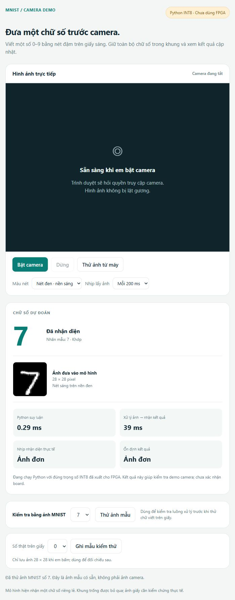
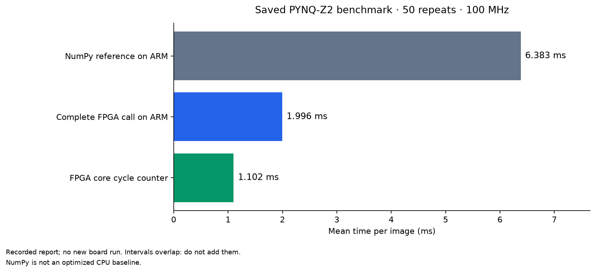

# MNIST INT8 MLP Accelerator on PYNQ-Z2

[Tiếng Việt](#tiếng-việt) · [English below](#english)

## Tiếng Việt

### Giới thiệu

Dự án xây dựng hệ thống nhận diện chữ số viết tay trên **PYNQ-Z2 (Zynq-7020)**, kết hợp huấn luyện MLP bằng PyTorch, lượng tử hóa số nguyên, thiết kế RTL và giao diện camera trên trình duyệt. Mạng **784 → 128 → 64 → 10** nhận ảnh **28 × 28**, sử dụng trọng số **INT8**, bias/tích lũy **INT32**, cùng activation **UINT8**.

Phần cứng giao tiếp với ARM qua **AXI4-Lite/MMIO**. Trọng số nằm trong ROM/BRAM của bitstream; driver gửi ảnh, khởi động tính toán và đọc kết quả. Camera đặt ở laptop; chế độ remote gửi ảnh đã chuẩn hóa sang board qua mạng nội bộ.

**Tác giả:** Tran Minh Duc (Xavier) · **Giấy phép mã nguồn:** MIT.

### Luồng hệ thống

```text
PyTorch → INT8 export → Verilog RTL → Vivado → .bit + .hwh

Camera laptop → xử lý ảnh trên laptop → 28×28 UINT8
             → HTTP tới ARM → AXI4-Lite → FPGA MLP → chữ số 0–9
```

Ba backend gồm `software` (NumPy trên laptop), `fpga` (ARM gọi FPGA), `remote` (laptop gọi server FPGA). Backend remote kiểm tra fingerprint mô hình và so sánh kết quả tham chiếu; lỗi được báo trực tiếp, không tự chuyển sang CPU. Xem [kiến trúc](docs/ARCHITECTURE.md).

### Kết quả và phạm vi xác nhận

| Hạng mục | Kết quả lưu trong dự án |
|---|---|
| Đối chiếu tham chiếu trên board | 120/120 ca; PYNQ 3.1.1, ARMv7 |
| Clock / số chu kỳ FPGA | 100 MHz / 110208 chu kỳ |
| Tính toán trong lõi | 1.10208 ms/ảnh |
| Toàn bộ lời gọi FPGA trên ARM | Trung bình 1.996 ms; 50 lần benchmark |
| Tham chiếu NumPy trên ARM | Trung bình 6.383 ms; cùng ảnh và trọng số |
| Tỷ số thời gian NumPy / lời gọi FPGA | Khoảng 3.20× với baseline này |
| Timing sau place-and-route | Setup +0.906 ns; hold +0.043 ns |
| Tài nguyên | 2211 LUT, 2002 FF, 35 BRAM tile, 1 DSP |

Đây là **báo cáo board đã lưu**, đã đối chiếu fingerprint và hash cặp `.bit/.hwh`; việc đóng gói không chạy lại board. Đồng hồ báo cáo ghi 2025-05-03 trong khi header bitstream ghi 2026-10-16, nên chưa xác lập ngày đo tuyệt đối. Manifest build ghi `actual_board_test_performed: false` vì chỉ mô tả bước build; báo cáo board riêng mô tả bước thử sau đó.

Kết quả số nguyên **97.64% trên 10000 ảnh MNIST** có sử dụng tập test để chọn shift, vì vậy không phải đánh giá trên holdout chưa từng được dùng để hiệu chỉnh. 120 ca kiểm tra tính tương đương với tham chiếu, không phải 120 nhãn ground-truth đều đúng. Chưa có độ chính xác camera được đánh giá trên tập có nhãn; báo cáo có **0 mẫu camera có nhãn**. Xem [kiểm chứng và hiệu năng](docs/VALIDATION.md).

### Chạy nhanh trên laptop

Cài Python 3.10 trở lên. Tại thư mục gốc repository:

```bash
python -m venv .venv
# Windows PowerShell: .\.venv\Scripts\Activate.ps1
# Linux/macOS: source .venv/bin/activate
python -m pip install -r requirements.txt
python camera_demo/app.py --backend software --self-test
```

Mở **http://127.0.0.1:8765**, bấm **Thử ảnh mẫu**, rồi **Bật camera**. Mặc định chạy NumPy, chưa dùng FPGA. Để chạy trên board, tải gói nạp từ Releases và làm theo [hướng dẫn đầy đủ](docs/GETTING_STARTED.md). Không cần cài PyTorch/Vivado cho demo suy luận có sẵn.

### Các thành phần trong repository

| Thư mục / tệp | Nội dung |
|---|---|
| `camera_demo/` | Server, giao diện web, tiền xử lý, 3 backend, mô hình số nguyên |
| `rtl/`, `sim/` | Accelerator, AXI wrapper, testbench, bộ nhớ mẫu |
| `pynq/` | Driver PYNQ và smoke test |
| `hardware/` | Tcl/PowerShell đóng gói IP và build overlay |
| `validation/`, `scripts/` | Golden fixtures, kiểm thử host, chuẩn bị workspace |
| `evidence/` | Báo cáo mô hình, build, board và nguồn gốc bằng chứng |
| `docs/` | Hướng dẫn, sơ đồ, lỗi và hình minh chứng |
| `train_mlp_mnist.py`, `export_for_fpga.py` | Huấn luyện và xuất trọng số |

Tệp `.bit/.hwh`, checkpoint tùy chọn và installer nằm trong **GitHub Releases**; không đưa SD image, môi trường Python, dữ liệu camera cá nhân, dataset đầy đủ và thư mục build lên Git. Xem [đóng gói và giấy phép thành phần](THIRD_PARTY_NOTICES.md).

### Hình minh chứng và tài liệu

**Nhận diện chữ số viết tay qua camera**

<table>
<tr>
<td align="center"><br><b>Chữ số 4 → dự đoán 4</b></td>
<td align="center"><br><b>Chữ số 8 với nét mờ có chủ đích → dự đoán 8</b></td>
</tr>
</table>

Hai ảnh demo do tác giả cung cấp cho thấy camera nhận diện chữ số **4** và **8** trên giấy. Ở ví dụ số **8**, tác giả **chủ động vẽ thêm các nét không đủ đậm để thử xem hệ thống có còn nhận diện đúng số 8**. Giao diện trong ảnh hiển thị kết quả từ FPGA; đây là ví dụ trực quan của từng lần thử, chưa phải phép đánh giá accuracy camera trên tập dữ liệu. Xem [minh chứng camera và mô tả thử nghiệm](docs/CAMERA_DEMO.md).

**Ảnh mẫu có sẵn và benchmark**



Ảnh giao diện được lưu từ chế độ **Python INT8**, mẫu 7 → 7; không dùng ảnh này để khẳng định FPGA hay độ chính xác camera. Biểu đồ dưới đây được dựng lại từ số liệu benchmark đã lưu, không phải lần đo mới:



- [Bắt đầu và nạp board](docs/GETTING_STARTED.md)
- [Demo camera: số 4 và số 8 với nét mờ chủ đích](docs/CAMERA_DEMO.md)
- [Kiến trúc và thanh ghi](docs/ARCHITECTURE.md)
- [Kiểm chứng, hiệu năng và giới hạn](docs/VALIDATION.md)
- [Lỗi đã gặp và cách xử lý](docs/TROUBLESHOOTING.md)
- [Huấn luyện, mô phỏng và rebuild](docs/REPRODUCING.md)
- [Thay đổi khi chuẩn bị bản công khai](docs/PUBLICATION_NOTES.md)

Mọi tài liệu trên đều có bản tiếng Anh đầy đủ bên dưới. Mã nguồn gốc của dự án được phát hành theo [MIT](LICENSE); điều khoản của thư viện, công cụ và dữ liệu bên thứ ba vẫn áp dụng riêng.

---

## English

### Overview

This project implements handwritten digit recognition on the **PYNQ-Z2 (Zynq-7020)**, combining PyTorch MLP training, integer quantization, RTL design and a browser camera interface. The **784 → 128 → 64 → 10** network accepts **28 × 28** images, using **INT8** weights, **INT32** biases/accumulators and **UINT8** activations.

The hardware communicates with ARM through **AXI4-Lite/MMIO**. Weights reside in the bitstream's ROM/BRAM; the driver uploads an image, starts computation and reads the result. The camera stays on the laptop; remote mode sends normalized images to the board over a private network.

**Author:** Tran Minh Duc (Xavier) · **Source code license:** MIT.

### System flow

```text
PyTorch → INT8 export → Verilog RTL → Vivado → .bit + .hwh

Laptop camera → preprocessing on laptop → 28×28 UINT8
              → HTTP to ARM → AXI4-Lite → FPGA MLP → digit 0–9
```

The three backends are `software` (NumPy on the laptop), `fpga` (ARM calls the FPGA), and `remote` (the laptop calls the FPGA server). Remote mode checks the model fingerprint and compares the reference prediction; errors are reported directly without automatic CPU fallback. See [architecture](docs/ARCHITECTURE.md).

### Results and verification scope

| Item | Result recorded in the project |
|---|---|
| Board reference comparison | 120/120 cases; PYNQ 3.1.1, ARMv7 |
| FPGA clock / cycle count | 100 MHz / 110208 cycles |
| Core computation | 1.10208 ms/image |
| Complete FPGA call on ARM | Mean 1.996 ms; 50 benchmark repeats |
| NumPy reference on ARM | Mean 6.383 ms; identical images and weights |
| NumPy time / FPGA call time | About 3.20× against this baseline |
| Post-route timing | Setup +0.906 ns; hold +0.043 ns |
| Resources | 2211 LUT, 2002 FF, 35 BRAM tiles, 1 DSP |

These are **saved board measurements**, checked against the model fingerprint and paired `.bit/.hwh` hashes; packaging did not rerun the board. The report clock says 2025-05-03 while the bitstream header says 2026-10-16, so the absolute measurement date has not been established. The build manifest says `actual_board_test_performed: false` because it describes only the build stage; the separate board report describes the subsequent hardware test.

The integer result of **97.64% on 10000 MNIST images** uses the test set to select shifts, so it is not an evaluation on an untouched holdout. The 120 cases check equivalence to the reference, rather than 120 correct ground-truth labels. Camera accuracy has not been evaluated on a labeled dataset; the report contains **0 labeled camera samples**. See [validation and performance](docs/VALIDATION.md).

### Laptop quick start

Install Python 3.10 or later. From the repository root:

```bash
python -m venv .venv
# Windows PowerShell: .\.venv\Scripts\Activate.ps1
# Linux/macOS: source .venv/bin/activate
python -m pip install -r requirements.txt
python camera_demo/app.py --backend software --self-test
```

Open **http://127.0.0.1:8765**, click **Thử ảnh mẫu** (test sample), then **Bật camera** (enable camera). The default uses NumPy and does not use the FPGA. For board execution, download the deployment package from Releases and follow the [complete guide](docs/GETTING_STARTED.md). PyTorch/Vivado are not required for the supplied inference demo.

### Repository contents

| Directory / file | Contents |
|---|---|
| `camera_demo/` | Server, web interface, preprocessing, 3 backends, integer model |
| `rtl/`, `sim/` | Accelerator, AXI wrapper, testbenches, sample memories |
| `pynq/` | PYNQ driver and smoke test |
| `hardware/` | Tcl/PowerShell IP packaging and overlay build |
| `validation/`, `scripts/` | Golden fixtures, host checks, workspace preparation |
| `evidence/` | Model, build and board reports with evidence provenance |
| `docs/` | Guides, diagrams, troubleshooting and evidence images |
| `train_mlp_mnist.py`, `export_for_fpga.py` | Training and weight export |

The `.bit/.hwh` files, optional checkpoint and installer belong in **GitHub Releases**; SD images, Python environments, private camera captures, the full dataset and build directories are excluded from Git. See [packaging and component licensing](THIRD_PARTY_NOTICES.md).

### Evidence images and documentation

**Handwritten digit recognition through the camera**

<table>
<tr>
<td align="center"><br><b>Digit 4 → prediction 4</b></td>
<td align="center"><br><b>Digit 8 with deliberately added faint strokes → prediction 8</b></td>
</tr>
</table>

The two author-provided demo images show the camera recognizing digits **4** and **8** on paper. In the **8** example, the author **deliberately added faint strokes to test whether the system would still correctly recognize the digit as 8**. The interface in the images indicates FPGA inference; these are visual examples of individual trials rather than a dataset-level camera accuracy evaluation. See [camera evidence and experiment description](docs/CAMERA_DEMO.md).

**Built-in sample and benchmark**


The saved interface image uses **Python INT8**, showing sample 7 → 7; it does not establish FPGA execution or camera accuracy. The chart below was generated from saved benchmark numbers, rather than a new measurement:


- [Getting started and board deployment](docs/GETTING_STARTED.md)
- [Camera demo: digit 4 and digit 8 with deliberate faint strokes](docs/CAMERA_DEMO.md)
- [Architecture and registers](docs/ARCHITECTURE.md)
- [Validation, performance and limitations](docs/VALIDATION.md)
- [Encountered issues and remedies](docs/TROUBLESHOOTING.md)
- [Training, simulation and rebuilding](docs/REPRODUCING.md)
- [Changes made for public packaging](docs/PUBLICATION_NOTES.md)

All documents above have complete English sections below their Vietnamese sections. Original project source is released under [MIT](LICENSE); third-party libraries, tools and datasets retain their own terms.
