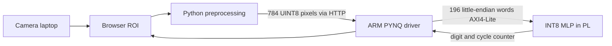

# Architecture / Kiến trúc

[Tiếng Việt](#tiếng-việt) · [English below](#english)

## Tiếng Việt

### Mô hình số nguyên

Mạng fully connected có 784 đầu vào, hai tầng ẩn 128/64 neuron và 10 đầu ra. Pixel là UINT8 0..255, không chia 255 trong đường số nguyên. Trọng số INT8 dùng khoảng -127..127; bias và accumulator là INT32. Hai tầng ẩn thực hiện `clip(ReLU(acc) >> shift, 0, 255)` với shift 12 và 8. Tầng cuối chọn argmax của 10 logits, không tính softmax trong FPGA.

Trọng số được đọc từ `.mem` khi tổng hợp để tạo ROM/BRAM. Thay `.mem` hoặc mô hình Python mà không rebuild bitstream sẽ làm sai cặp mô hình. SHA256 của 6 tệp trọng số, bitstream và HWH được lưu trong `camera_demo/model/model.json`.

### Phân chia ARM và FPGA

`rtl/mlp_accelerator.v` dùng MAC tuần tự có pipeline, tái sử dụng bộ nhân và bộ nhớ. `rtl/mlp_axi_lite.v` xử lý giao dịch AXI, pixel buffer và thanh ghi. `pynq/mnist_driver.py` đóng gói bốn pixel vào mỗi word 32-bit, ghi MMIO hàng loạt rồi poll DONE với timeout và khóa truy cập.

Base address **0x40000000**, aperture **64 KiB**, instance **mlp_ai_0**, VLNV **mnist.local:user:mlp_axi_lite:1.0**. Đây là AXI4-Lite/MMIO, không sử dụng AXI DMA, TLAST hay HDMI. Đường camera xử lý trên laptop; ARM gọi phần cứng và trả kết quả. Wrapper FPGA còn đối chiếu với NumPy để phát hiện sai lệch, làm tăng chi phí demo.

### Thanh ghi và điều khiển

| Offset | Ý nghĩa |
|---|---|
| 0x00 CONTROL | Ghi bit0 START, bit1 ACK, bit2 SOFT_RESET |
| 0x04 STATUS | Bit0 BUSY, bit1 DONE, bit2 ERROR, bit3 IMAGE_READY |
| 0x08 RESULT | Chữ số 0–9 |
| 0x0C CYCLES | Số chu kỳ phần cứng |
| 0x10 CLOCK | Clock cấu hình, Hz |
| 0x14 IMAGE_SIZE | 784 |
| 0x18 ID | 0x4D4C5031 |
| 0x1C LOADED | Số byte pixel đã nạp |
| 0x20 DEBUG | Trạng thái debug RTL |
| 0x24 ERROR | Mã lỗi phần cứng |
| 0x28 IRQ_ENABLE | Cho phép ngắt; driver demo dùng polling |
| 0x1000..0x130C | 196 word pixel 32-bit, little endian |

Driver xác minh ID/kích thước, ACK trạng thái cũ, upload đủ 784 pixel, START, poll DONE/ERROR, đọc kết quả và ACK. Timeout không đồng nghĩa board hỏng: giữ trạng thái để kiểm tra rồi gọi `soft_reset()` trước khi gửi lại. Soft reset vô hiệu ảnh cũ; lần sau phải upload lại.

Driver hiện giữ workaround clock của môi trường PYNQ cũ trong `load_overlay`; không tuyên bố tương thích mọi image PYNQ mới. Khi đổi image/board preset, kiểm tra clock thực tế và chạy lại toàn bộ bài test board.

---

## English

### Integer model

The fully connected network has 784 inputs, hidden layers of 128/64 neurons and 10 outputs. Pixels are UINT8 0..255, without division by 255 in the integer path. INT8 weights use -127..127; biases and accumulators are INT32. Both hidden layers compute `clip(ReLU(acc) >> shift, 0, 255)` with shifts 12 and 8. The final layer selects the argmax of 10 logits, without FPGA softmax.

Weights are read from `.mem` files during synthesis to create ROM/BRAM. Changing `.mem` files or the Python model without rebuilding the bitstream breaks the model pairing. SHA256 values for 6 weight files, the bitstream and HWH are stored in `camera_demo/model/model.json`.

### ARM/FPGA partition

`rtl/mlp_accelerator.v` uses a pipelined sequential MAC, reusing its multiplier and memories. `rtl/mlp_axi_lite.v` handles AXI transactions, the pixel buffer and registers. `pynq/mnist_driver.py` packs four pixels into each 32-bit word, bulk-writes MMIO and polls DONE using a timeout and access lock.

The base address is **0x40000000**, with a **64 KiB** aperture, instance **mlp_ai_0**, and VLNV **mnist.local:user:mlp_axi_lite:1.0**. This is AXI4-Lite/MMIO, without AXI DMA, TLAST or HDMI. Camera preprocessing runs on the laptop; ARM calls the hardware and returns results. The FPGA wrapper also compares against NumPy to detect mismatches, adding demo overhead.

### Registers and control

| Offset | Meaning |
|---|---|
| 0x00 CONTROL | Write bit0 START, bit1 ACK, bit2 SOFT_RESET |
| 0x04 STATUS | Bit0 BUSY, bit1 DONE, bit2 ERROR, bit3 IMAGE_READY |
| 0x08 RESULT | Predicted digit 0–9 |
| 0x0C CYCLES | Hardware cycle count |
| 0x10 CLOCK | Configured clock, Hz |
| 0x14 IMAGE_SIZE | 784 |
| 0x18 ID | 0x4D4C5031 |
| 0x1C LOADED | Number of uploaded pixel bytes |
| 0x20 DEBUG | RTL debug state |
| 0x24 ERROR | Hardware error code |
| 0x28 IRQ_ENABLE | Interrupt enable; the demo driver uses polling |
| 0x1000..0x130C | 196 little-endian 32-bit pixel words |

The driver validates ID/image size, ACKs previous status, uploads all 784 pixels, issues START, polls DONE/ERROR, reads the result and ACKs it. A timeout does not prove hardware damage: preserve the state for inspection, then call `soft_reset()` before resending. Soft reset invalidates the old image; the next call must upload it again.

The current `load_overlay` driver retains a clock workaround for its earlier PYNQ environment; compatibility with every newer PYNQ image is not claimed. When changing the image/board preset, verify the actual clock and rerun the full board tests.
