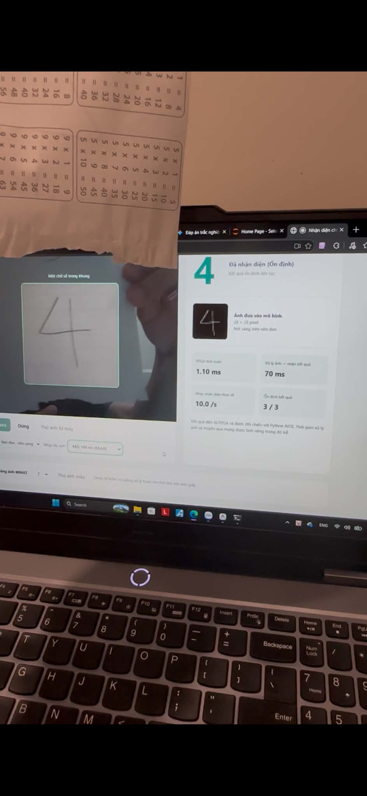
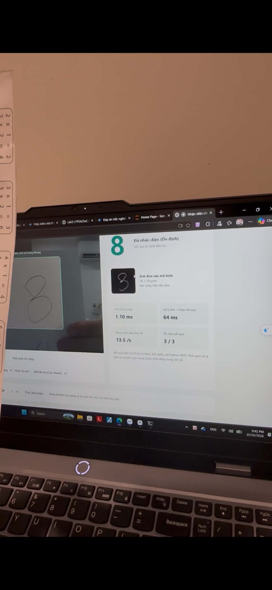

# Camera demonstration / Minh chứng nhận diện qua camera

[Tiếng Việt](#tiếng-việt) · [English below](#english)

## Tiếng Việt

### Chữ số 4 viết trên giấy

Ảnh do tác giả cung cấp cho thấy chữ số **4** viết trên giấy trong khung camera, ảnh **28 × 28** sau tiền xử lý và kết quả nhận diện **4** trên giao diện. Đây là minh chứng dùng camera với chữ trên giấy, khác với nút thử ảnh MNIST có sẵn. Giao diện ảnh hiển thị mục suy luận FPGA và trạng thái kết quả ổn định **3/3**.

### Chữ số 8 với các nét mờ được thêm có chủ đích

Ở thử nghiệm này, tác giả **cố tình vẽ thêm những nét không đủ đậm** để xem hệ thống có còn nhận diện đúng chữ số **8** hay không. Đây là điều kiện thử có chủ đích, không phải ví dụ được chọn vì chữ viết xấu.

Giao diện trong ảnh vẫn hiển thị kết quả **8**, kèm ảnh đầu vào đã chuẩn hóa và trạng thái ổn định **3/3**. Ví dụ này minh họa kết quả ở một trường hợp có nét mờ bổ sung; không suy rộng thành khả năng chống mọi loại nhiễu hoặc bảo đảm mọi chữ số tương tự đều được nhận diện đúng.

### Nguồn ảnh và phạm vi minh chứng

Hai ảnh được tác giả cung cấp để bổ sung vào bản công khai và được giữ nguyên byte, không cắt ghép hay chỉnh nét. Hash và mô tả từng ảnh nằm trong [camera_demo_examples.json](../evidence/camera_demo_examples.json). Ngày bổ sung tài liệu không được dùng làm ngày chụp hoặc ngày đo hiệu năng.

Các số thời gian và trạng thái trong ảnh là thông tin hiển thị của demo tại thời điểm chụp, không phải benchmark mới trong lần cập nhật tài liệu này. **3/3** biểu thị ba dự đoán liên tiếp giống nhau, không phải xác suất đúng. Báo cáo board cũ vẫn giữ **0 mẫu camera có nhãn**; hai ảnh minh họa được lưu riêng, không thay đổi report hay dùng để tính phần trăm accuracy camera. Xem [kiểm chứng và hiệu năng](VALIDATION.md).

---

## English

### Digit 4 written on paper

The author-provided image shows a handwritten **4** on paper within the camera ROI, its preprocessed **28 × 28** image, and the prediction **4** in the interface. This illustrates camera use with a digit on paper, distinct from the built-in MNIST sample button. The pictured interface displays FPGA inference and a stable result of **3/3**.

### Digit 8 with deliberately added faint strokes

For this experiment, the author **intentionally added strokes that were not fully dark** to test whether the system would still correctly recognize the digit as **8**. This is a deliberate test condition, rather than an example selected for poor handwriting.

The pictured interface still displays **8**, along with the normalized input and a stable result of **3/3**. This illustrates the result for one case with added faint strokes; it does not establish robustness against all noise types or guarantee correct recognition of every similar digit.

### Image provenance and evidence scope

The author supplied both images for the public package, and their bytes are preserved without cropping, compositing or stroke edits. Image hashes and descriptions are recorded in [camera_demo_examples.json](../evidence/camera_demo_examples.json). The documentation update date is not treated as the capture date or performance measurement date.

The timings and states visible in the images are the demo's displayed information at capture time, rather than a new benchmark for this documentation update. **3/3** means three consecutive identical predictions, not a probability of correctness. The original board report still has **0 labeled camera samples**; these two illustrations are stored separately, without changing the report or calculating a camera accuracy percentage. See [validation and performance](VALIDATION.md).
